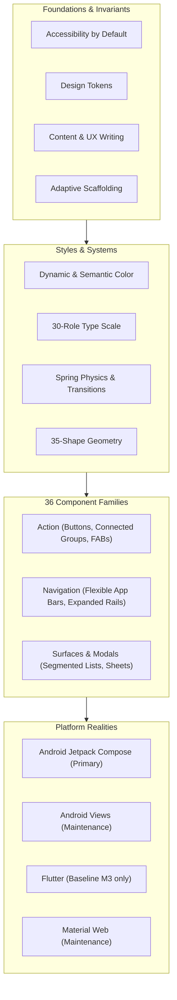

# Material 3 Expressive Knowledge Base

> **An evidence-backed engineering reference, design system specification, and token catalog for Material Design 3 and its M3 Expressive evolution.**

[](https://github.com/meetkapadia1710-tech/m3-expressive-agent-knowledge-base/actions/workflows/validate.yml)
[](LICENSE)
[](token-catalog.md)
[](implementation.md)

> [!NOTE]
> **Independent Community Research:** This repository is an independent, evidence-backed reference and engineering toolset researched on **27–28 October 2026 (Asia/Calcutta)** using live browser captures, published Angular application payloads, and official platform documentation. It is not affiliated with, sponsored by, or endorsed by Google LLC. Material Design, Android, and Flutter are trademarks of Google LLC.

---

## Overview: Material 3 & M3 Expressive

**M3 Expressive is an expansion of [Material Design 3](https://m3.material.io/), not an unreleased "Material 4."** It provides product teams with heightened emotional resonance, richer typographic emphasis, physical spring dynamics, and a library of 35 expressive shapes while retaining the core foundations of dynamic color, accessible semantics, and responsive adaptive layout.



---

## AI Agents & LLM Quick Start

This repository is optimized for autonomous coding agents (Gemini, Claude, Cursor, Copilot, Antigravity) to learn and implement Material 3 Expressive without hallucinations:

* **[MCP Server](MCP.md):** Connect via Model Context Protocol (`python mcp_server.py`) to query component specs, 8,897 tokens, and platform support directly from Cursor, Claude Desktop, or Antigravity.
* **[llms.txt](llms.txt):** The open standard index distilling architecture, component replacement rules, and platform constraints into a clean, zero-noise prompt file.
* **Offline Semantic Search:** Instant, dependency-free keyword search across all authored guides and 88 extracted source documents:
  ```powershell
  python tools/search.py "button groups"
  python tools/search.py "dynamic color" --limit 10
  ```
* **Offline Verification:** Validates deliverable completeness, manifest integrity, and 8,897 token declarations in seconds:
  ```powershell
  python tools/validate_kb.py
  ```

---

## Topic Guides & System Architecture

Authored syntheses providing qualified facts, source pointers, and critical design decisions:

| Domain | Guide | Core Guidance & Scope |
|---|---|---|
| **Principles** | [Foundations and principles](foundations.md) | Material 3 and Expressive pillars, inclusive co-design, vendor research synthesis, and UX writing |
| **Color** | [Color system](color.md) | Semantic color roles, tonal palettes, dynamic extraction, static harmonization, and contrast minimums |
| **Typography** | [Typography scale](typography.md) | 30 baseline and emphasized styles, variable font axes (wght, wdth, opsz, ROND), and script scaling |
| **Layout** | [Layout and scaffolding](layout.md) | Breakpoint grids, pane scaffolds, adaptive canonical patterns, density tiers, and RTL handling |
| **Components** | [Component catalog](components.md) | 36 component families, interactive states, accessibility criteria, and modern Expressive variants |
| **Tokens** | [Design tokens](design-tokens.md) | System-reference-component hierarchy, token provenance, naming conventions, and design-to-code pipeline |
| **Token Catalog** | [Token catalog](token-catalog.md) | Searchable database of 8,897 token occurrences across 41 public module endpoints |
| **Accessibility** | [Accessibility standards](accessibility.md) | Focus rings, 48dp target sizing, keyboard navigation, text contrast, screen-reader semantics, and audit guidance |
| **Motion & Shape** | [Motion, shape and icons](motion-shape-icons.md) | Physics-based spring curves, spatial transitions, the 35-shape scale, and Material Symbols |
| **Interaction** | [Interaction, elevation and content](interaction-elevation-content.md) | Hover/focus/pressed state layers, elevation tone mapping, selection affordances, and meaningful copy |
| **Implementation** | [Implementation and platform status](implementation.md) | Compose-first Android reality, Views maintenance, Flutter M3 baseline limits, Web status, and M2 migration |

---

## Expressive Invariants & Replacement Rules

When designing or writing code with Material 3 Expressive, adhere to these verified recommendations:

| Component / Pattern | Baseline M3 Guidance | M3 Expressive Direction | Why |
|---|---|---|---|
| **Action Groups** | Segmented Buttons | **Connected Button Groups** | Improves container cohesion and clear primary/secondary hierarchy |
| **Primary Action** | Small / Surface FAB | **Standard, Medium, or Large FAB** | Small and surface-color FABs are deprecated; larger touch targets enhance accessibility |
| **Multi-Actions** | Speed Dials / Stacked FABs | **FAB Menus** | Consolidates 2–6 related actions into a single accessible pop-up menu container |
| **Window Navigation** | Navigation Drawer | **Expanded Navigation Rail** | Provides seamless responsive transitions across compact, medium, and expanded viewports |
| **Touch Targets** | 48×48 dp recommended | **48×48 dp mandatory** | Strict compliance with WCAG 2.5.5 / 2.5.8 target sizes across all interactive controls |
| **Typography** | 15 baseline styles | **30 styles (Baseline + Emphasized)** | Introduces dedicated emphasized roles for scannable, expressive headlines and buttons |

---

## Implementation & Platform Reality Matrix

A component's presence in design documentation does **not** imply universal platform availability. Official platform readiness:

| Platform Library | Published Status | Guidance for Production Apps |
|---|---|---|
| **Android (Jetpack Compose)** | **Primary (Compose-first)** | New Android development belongs here. Receives M3 Expressive components and token updates first. |
| **Android Views (`MDC-Android`)** | **Maintenance Mode** | Receives critical security and bug fixes only. Plan migration to Compose for modern Expressive features. |
| **Flutter (`flutter/material`)** | **Active (Baseline M3 only)** | Supports baseline Material 3. The official documentation explicitly confirms **M3 Expressive is not implemented on Flutter**. |
| **Material Web (`@material/web`)** | **Maintenance Mode** | Shipped Web Components are in maintenance mode; Expressive is not implemented. Angular teams use Angular Material. |
| **Native iOS (`material-components-ios`)** | **Archived (Read-only)** | Officially archived on December 11, 2025. Not maintained for modern M3 or Expressive. |

---

## Verifiable Evidence Corpus

The knowledge base maintains an uncompromised audit trail of every source document, network request, and rendered DOM snapshot:

* [Coverage report](coverage-report.md): Exact inventory of what was retrieved, rendered, reviewed, or left untested.
* [Research method](research-method.md): Reverse-engineering methodology, evidence hashes, acquisition parameters, and reproducibility rules.
* [Source index](sources.md): Master catalog of 263 ledger-qualified citations.
* [Published-page inventory (CSV)](evidence/source-inventory.csv) & [JSON](evidence/source-inventory.json): 88 versioned page documents and 259 visible sections with SHA-256 signatures.
* [Sitemap coverage (CSV)](evidence/sitemap-coverage.csv) & [JSON](evidence/sitemap-coverage.json): Status per URL for all 375 sitemap entries.
* [Rendered snapshots](evidence/rendered-manifest.json): 27 headless browser captures recording DOM trees, accessibility nodes, and route resolutions.
* [Token-module manifest](evidence/module-data-manifest.json): 41 unique public token data endpoints backing the system catalog.

---

## Local Verification & Search

```powershell
# Run the offline search tool
python tools/search.py "focus indicator"
python tools/search.py "elevation" --limit 5

# Validate evidence integrity and token pointers
python tools/validate_kb.py
```

`evidence/page-text/` contains plain-text extracts of all visible published sections for instant indexing; `evidence/page-data/` stores the verbatim JSON payloads.

---

## Licensing

- **Code & Tooling (`tools/`):** Licensed under the [MIT License](LICENSE).
- **Documentation & Syntheses (`*.md`):** Licensed under the [Creative Commons Attribution 4.0 International License (CC BY 4.0)](LICENSE).
